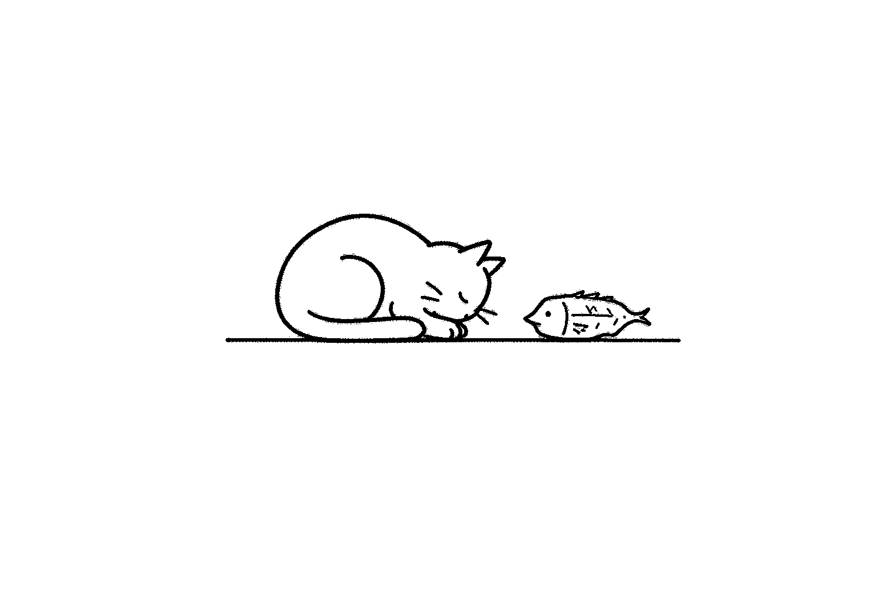

+++
date = '2026-10-28T00:00:00+08:00'
draft = false
title = '有一种心头痒叫老猫枕咸鱼'
featuredImage = "/images/covers/cat-and-salted-fish.jpg"
featuredImagePreview = "/images/covers/cat-and-salted-fish-preview.jpg"
images = ["/images/covers/cat-and-salted-fish.jpg"]
+++

# 有一种心头痒叫老猫枕咸鱼

我上周前后喝下了两瓶 1.2L 的无糖可乐。

出于对健康方面的顾虑，我顺手问了一下 DSeek：阿斯巴甜对人体健康有什么影响？后来想想又有点可笑——喝都喝了呀。

咖啡那边，我已经一个多月不频繁喝了，大体上很少喝，总共也就喝了几杯。谈不上上瘾，但我主观上确实觉得，喝点咖啡或者可乐，能让我感到心情愉悦。

相比可乐，我认为手冲咖啡或许更健康。所以我打算用少量的咖啡替代可乐，作为偶尔愉悦心情的生活调味剂——但不能像以前那样喝得那么频繁了。

再往前想，每次一带咖啡豆在身边，总有一种老猫枕咸鱼的痒在心头。
