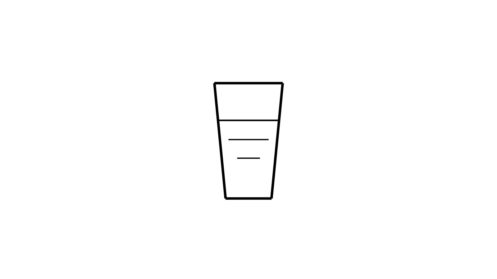

+++
date = '2026-11-03T13:45:19+08:00'
draft = false
title = '爱好'
featuredImage = "/images/covers/hobby.jpg"
featuredImagePreview = "/images/covers/hobby-preview.jpg"
images = ["/images/covers/hobby.jpg"]
lightgallery = true
tags = ['爱好', '随笔']
categories = ['生活']
+++

- > 爱好是需要金钱供养的
  > 有人喜欢喝咖啡 有人喜欢喝茶 有人喜欢喝好酒 有人喜欢抽好烟 有人喜欢开好车 有人喜欢住豪宅
- 我没有钱
- 我喜欢喝水
- 我喜欢呼吸
- 还喜欢睡觉
