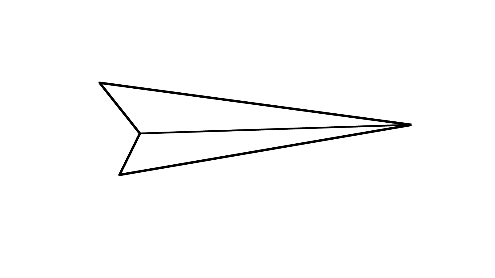

+++
date = '2026-11-01T21:03:40+08:00'
draft = false
title = '小记'
featuredImage = "/images/covers/reality-and-idealism.jpg"
featuredImagePreview = "/images/covers/reality-and-idealism-preview.jpg"
images = ["/images/covers/reality-and-idealism.jpg"]
lightgallery = true
tags = ['理想', '现实', '随笔']
categories = ['思考']
+++

# 现实和理想主义

- 我们在谈论类似于
- ***这件事情应该是这样，我的工作应该这样，我的生活应该这样***  的时候
- 我们的内心应该是有一种**明确的理想标准**在呐喊的。思想感情上的煎熬往往源自于***现实和理想的部分偏差或者相去甚远***
- 现实不管是这样还是那样总归是事出有因，倘若我们能接受存在即合理，***那么妥协便不会成为一种遗憾或者挫败***。
- 理想的美是距离的美，现实的美是务实的美，是不完美的完美。
- 接受存在即合理，***不强求改变只顺应跟协调***
- 如果能做到 ***让理想归理想，让现实归现实。***我们的身心应该会减少很多矛盾和苦恼
-
- **有一个观点值得我们去相信**
- 知识和技能是美好的两个物件，如果我们觉得为难甚至望而生畏，要么就是我们打开的方式不对，要么就是跟我们的天分不合。而前者居多。
